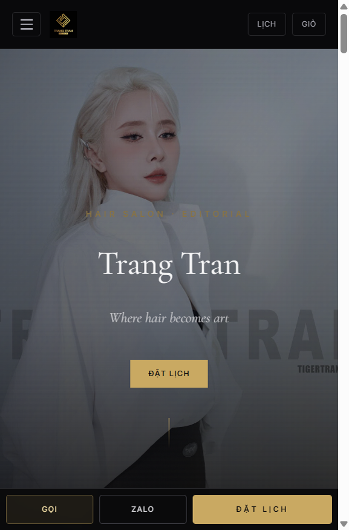
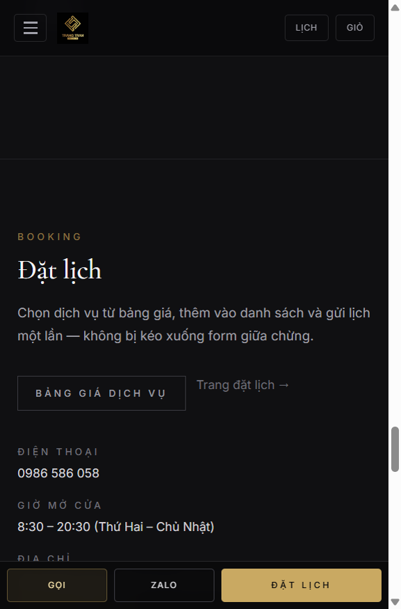
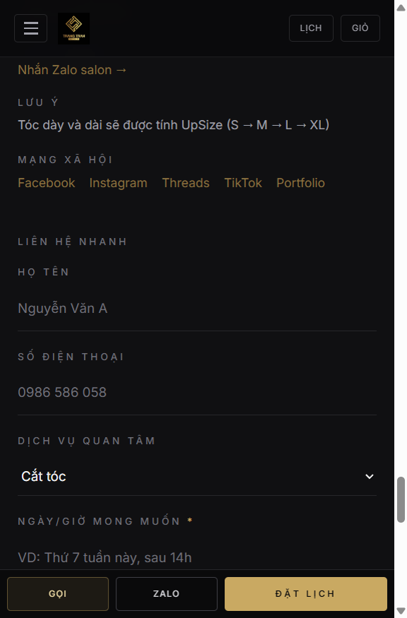
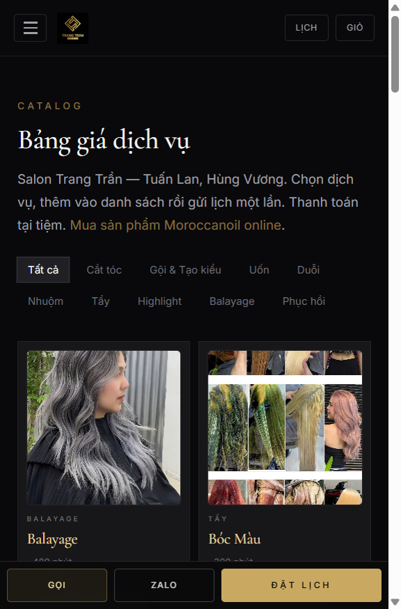
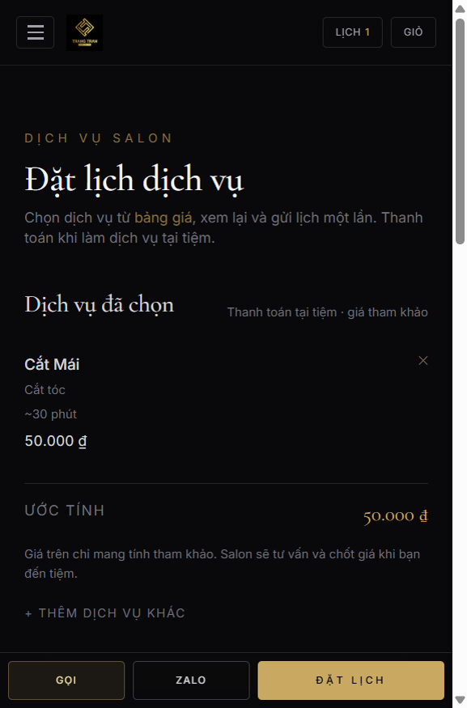
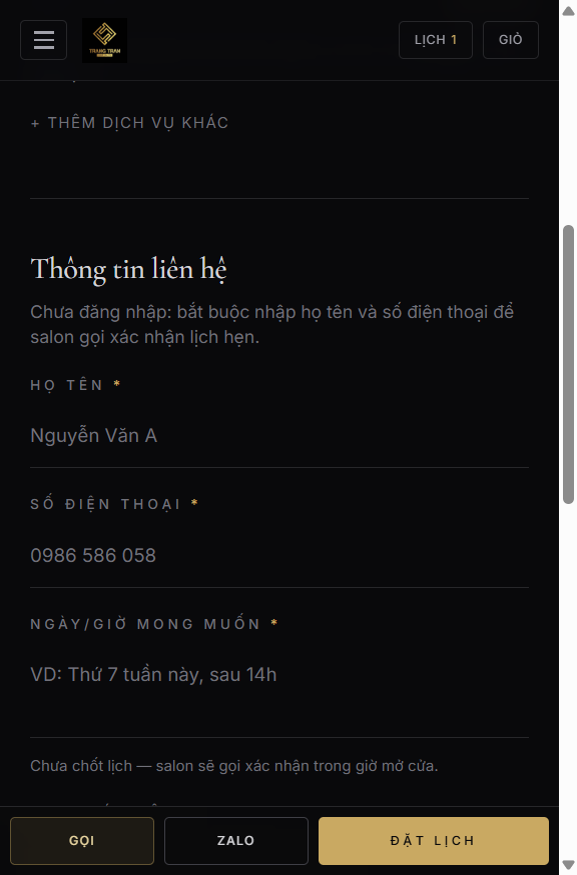

# Hướng dẫn khách đặt lịch trên web

Ảnh minh họa: [`docs/huong-dan-web/`](./huong-dan-web/)  
Web: https://trangtran-hair.pages.dev

---

## Caption đăng Facebook / Zalo (đã chốt)

```
Đặt lịch làm tóc không cần chờ inbox nữa

Trên web Trang Tran Hair, bạn có thể:
· Xem bảng giá rõ ràng
· Chọn dịch vụ + ghi ngày giờ mong muốn
· Gửi lịch chỉ với họ tên & SĐT
· Salon gọi xác nhận trong giờ mở cửa

Truy cập: https://trangtran-hair.pages.dev/appointment
Hoặc quét QR tại quầy / bấm “Đặt lịch” trên điện thoại

Hotline · Zalo: 0986 586 058
18–19 LK2 Tuấn Lan, Hùng Vương, TP. Sóc Trăng
8:30 – 20:30 (T2–CN)

Trang Tran Hair — Where hair becomes art.
```

---

## Album ảnh hướng dẫn (đăng kèm caption)

### 1. Trang chủ — bấm Đặt lịch



Vào https://trangtran-hair.pages.dev → bấm **ĐẶT LỊCH** (giữa màn hình hoặc nút vàng dưới cùng).

---

### 2. Mục Đặt lịch trên trang chủ



Có thể vào **Bảng giá dịch vụ** hoặc **Trang đặt lịch** để chọn nhiều dịch vụ.

---

### 3. Form liên hệ nhanh (trang chủ)



Điền họ tên, SĐT, dịch vụ quan tâm, **ngày/giờ mong muốn** → Gửi yêu cầu nhanh.

---

### 4. Bảng giá — chọn dịch vụ rồi Thêm



https://trangtran-hair.pages.dev/catalog → chọn dịch vụ → **Thêm** → mở **Lịch** / **Đặt lịch**.

---

### 5. Trang đặt lịch — dịch vụ đã chọn



https://trangtran-hair.pages.dev/appointment — kiểm tra danh sách dịch vụ (giá tham khảo, thanh toán tại tiệm).

---

### 6. Trang đặt lịch — điền thông tin & gửi



Bắt buộc: **Họ tên**, **SĐT**, **Ngày/giờ mong muốn**.  
Ghi chú thêm (tuỳ chọn). Bấm **Gửi yêu cầu đặt lịch** — salon gọi xác nhận trong giờ mở cửa.

---

## Gợi ý đăng

| Nơi | Cách |
|-----|------|
| Facebook | Caption + album 6 ảnh theo thứ tự 1→6 (ghim bài) |
| Zalo | Caption + gửi lần lượt vài ảnh chính (1, 4, 6) |
| TikTok / Reels | Quay clip 15–30s sau (không bắt buộc) |

**Chụp ảnh vs quay clip:** ảnh đủ cho bài hướng dẫn FB; clip chỉ cần khi muốn viral ngắn trên TikTok.
